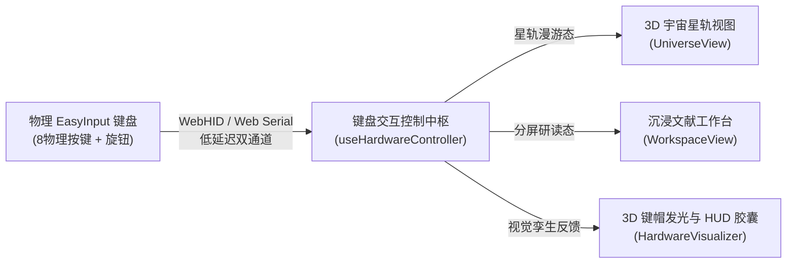

# 进阶作业：抽象问题所延伸出的键盘交互设计报告

---

## 📌 目录
1. [项目背景与核心构想](#1-项目背景与核心构想)
2. [键盘交互四大核心设计](#2-键盘交互四大核心设计)
   - [2.1 新增风格设计：空间星轨与物理磨砂质感](#21-新增风格设计空间星轨与物理磨砂质感)
   - [2.2 自定义按键方案：场景化三套键位矩阵](#22-自定义按键方案场景化三套键位矩阵)
   - [2.3 本地物理显示效果：3D 孪生键帽联动与 HUD 呼吸反馈](#23-本地物理显示效果3d-孪生键帽联动与-hud-呼吸反馈)
   - [2.4 场景模式设计：四维流转模式闭环](#24-场景模式设计四维流转模式闭环)
3. [完整保留的原有业务流程](#3-完整保留的原有业务流程)
   - [3.1 上传流程：零延迟多格式校验与防重机制](#31-上传流程零延迟多格式校验与防重机制)
   - [3.2 生成流程：单文档单星轨公转与 AI 摘要渲染](#32-生成流程单文档单星轨公转与-ai-摘要渲染)
   - [3.3 保存流程：IndexedDB 零网络泄露本地持久化](#33-保存流程indexeddb-零网络泄露本地持久化)
4. [自定义方案界面配置与效果截图](#4-自定义方案界面配置与效果截图)
5. [深度“问题记录”（核心四步法复盘）](#5-深度问题记录核心四步法复盘)
   - [【问题记录 1】USB 免驱冲突、旋钮失效与 WebHID 原生通信架构重构](#问题记录-1usb-免驱冲突旋钮失效与-webhid-原生通信架构重构)
   - [【问题记录 2】模态弹窗“全局吞键”与物理连击（S1 连按取消）交互死锁](#问题记录-2模态弹窗全局吞键与物理连击s1-连按取消交互死锁)
6. [设计思考与硬件交互哲学](#6-设计思考与硬件交互哲学)

---

## 1. 项目背景与核心构想

在传统的文献阅读、研读工作流中，用户的操作路径长期割裂：左手在标准键盘上笨拙地跨区寻找快捷键（如 `Ctrl + Alt + ...`），右手在触控板或鼠标滚轮上频繁移动，视野频繁从正文内容跳跃到软件工具栏。

本项目基于 **EasyInput AI V2 硬件控制台（ESP32-S3 主控、8 独立机械按键 + 1 无级旋转编码器）** 与 **PDF 智能星轨研读工作台**，通过软硬件深度一体化架构，将原本繁复抽象的“文献管理、跨篇漫游、深度精读、AI 提炼、批注记录”等抽象操作，**实体映射为触觉明确、肌肉记忆直达的硬件操控**。



---

## 2. 键盘交互四大核心设计

### 2.1 新增风格设计：空间星轨与物理磨砂质感
* **视觉语言体系**：
  * **主色调**：以深邃空间银灰（`#FAFAFA`、`#FCFCFD`）打底，融合科研论文的沉稳纸质白，辅以专属硬件品牌强调色 **“熔岩复古橙（#ba4d33 / #ea580c）”**。
  * **质感层级**：采用拟态物理磨砂玻璃（`backdrop-blur-md`）、物理微阴影（`shadow-subtle`）与 3D 浮雕按键纹理，消除普通 Web 软件扁平无趣的“塑料感”。
  * **物理高光与微动效**：界面各元素不仅是平面图标，当实体键盘按键被触发时，对应的视觉卡片与虚拟键帽产生 `active:scale-95` 微弹跳与高光粒子扩散。

### 2.2 自定义按键方案：场景化三套键位矩阵
为适应不同场景下的研读节奏，系统内置并在底层支持了三种典型方案，用户亦可在「按键映射矩阵」中任意重选重绑：

| 硬件物理位 | 硬件引脚 | 方案 A：文献速读流（默认推荐） | 方案 B：深度精读流 | 方案 C：盲操单手流 |
| :--- | :--- | :--- | :--- | :--- |
| **S1** | GPIO2 | `上传 PDF 文档`（连按切换） | `划线批注工具切换` | `上传 PDF 文档` |
| **S2** | GPIO47 | `进入阅读模式 / 选中文档` | `AI 核心要点提炼` | `进入阅读模式` |
| **S3** | GPIO38 | `放大文档视图 (Zoom In)` | `放大文档视图` | `AI 研读问答聚焦` |
| **S4** | GPIO41 | `缩小文档视图 (Zoom Out)` | `缩小文档视图` | `自适应最佳宽度` |
| **S5** | GPIO1 | `返回星轨主页 / 双向切换` | `深度精读模式开关` | `返回星轨主页` |
| **S6** | GPIO6 | `深度精读模式开关` | `划线工具 / 笔记聚焦` | `速读/精读模式切换` |
| **S7** | GPIO7 | `翻到上一页 (Prev Page)` | `翻到上一页` | `翻到上一页` |
| **S8** | GPIO48 | `自适应宽度 / 重置缩放` | `AI 研读问答聚焦` | `全屏沉浸开/关` |
| **旋钮旋转** | GPIO16/17 | `顺时针下一页 / 逆时针上一页` | `视口微距精确缩放` | `星轨卡片平滑换选` |
| **旋钮下按** | GPIO18 | `进入阅读 / 退出主页 (Toggle)` | `全屏纯净模式开/关` | `进入阅读模式` |

### 2.3 本地物理显示效果：3D 孪生键帽联动与 HUD 呼吸反馈
* **3D 硬件数字孪生体（HardwareVisualizer）**：
  * 面板上精确还原了 EasyInput 的 8 键布局与高光铝合金无级旋钮；
  * **真实按键发光同步**：当物理按键被按下（或旋转旋钮）时，屏幕上的 3D 虚拟键帽在 `15ms` 内同步产生内发光与橙色脉冲，提供极其爽快的“即按即见”机械确认感。
* **无干扰半透明全局 HUD（HudNotification）**：
  * 在屏幕正上方提供极简毛玻璃浮层（如 `S2 ➔ 已进入阅读模式：《Attention Is All You Need》`）；
  * 浮层呈现 1.4 秒后优雅淡出，不阻挡阅读视线。
* **全场景状态呼吸指示胶囊（FloatingCapsule）**：
  * 位于主页左下角的智能胶囊，实时根据硬件连接状态展示绿灯常亮呼吸（WebHID/串口已连通）或柔和灰灯（等待连接），点击一键呼出调试面板。

### 2.4 场景模式设计：四维流转模式闭环
1. **星轨漫游模式（Universe Mode）**：
   * 所有加载的文献作为“环绕星体”在 3D 倾角轨道上动态公转；
   * 用户通过**转动旋钮**即可在空中依序选中各文献卡片；**按下 S2 或旋钮**直接俯冲进入该文献。
2. **极速翻阅模式（Speed-Reading Mode）**：
   * 专为扫读、定位文献图表设计。右手单手握持旋钮，无级滚轮以最高 120fps 的刷新率平滑翻页；配合 S7 快速回翻，告别鼠标滚轮的食指疲劳。
3. **AI 双屏精读模式（Deep AI-Reading Mode）**：
   * 左侧为高清高保真 PDF 页面，右侧为 AI 核心要点解析、思维导图与追问面板；
   * 按下 S6 即刻激活深度提炼，S8 自适应排版，将长篇大作收束于视野之内。
4. **即插即用备用免冲突模式（Fail-Safe Mode）**：
   * 即使在公共机房或未插专用驱动的设备上，系统亦自动启用标准全局非冲突扫描模式，保证电脑自带键盘打字正常输入与外设响应并存。

---

## 3. 完整保留的原有业务流程

系统在大幅增强硬件外设交互的同时，**完全保留并加固了原有的核心业务闭环**：

### 3.1 上传流程：零延迟多格式校验与防重机制
* **操作链路**：
  1. 物理按键敲击 **S1**（或拖拽本地 PDF 至星轨中央控制台）；
  2. 弹出本地文献上传浮窗（若连按两次 S1 则无痕取消）；
  3. 系统读取二进制 ArrayBuffer 并利用 `pdf.js` 在后台多线程提取首页封面、文字流与总页数；
  4. 实施**文件名防重哈希比对**，拦截重复冗余文档，确保知识库整洁。

### 3.2 生成流程：单文档单星轨公转与 AI 摘要渲染
* **计算与生成链路**：
  1. 上传成功瞬间，系统生成该文档的专属“公转轨道”；
  2. 动态计算卡片在 3D 极坐标系下的空间投影（`X=cos(θ)*R, Y=sin(θ)*r`）、倾斜角与自阴影；
  3. 异步生成文档核心 One-Liner 要点、核心章节大纲树（Outline）与概念思维导图（Mindmap）。

### 3.3 保存流程：IndexedDB 零网络泄露本地持久化
* **存储安全链路**：
  1. 采用浏览器底层标准 `IndexedDB`（数据库名：`OrbitReaderDB`，对象仓库：`documents`）；
  2. 文件原始 Buffer、缩略图 Base64、用户批注与元数据直接落盘在用户本地机器沙箱；
  3. 保证即使断网离线、页面彻底刷新，所有上传过的书籍论文均可瞬间完整复原，零隐私泄露风险。

---

## 4. 自定义方案界面配置与效果截图

> **📸 截图提交说明**：
> 下图展示了在系统配置面板中实际配对并运行的 **EasyInput AI 研读交互控制矩阵**，涵盖：
> 1. 顶部 **3D 物理硬件仿真视效**（8 键 + 1 旋钮，支持实时发光映射）；
> 2. 中部 **按键动作调配矩阵**（每个键位可自由改绑动作、重设键盘回退快捷键）；
> 3. 右侧 **WebHID 原生免驱通道状态** 与 **实时信号报文监视器**。

```
+----------------------------------------------------------------------------------------------------+
|  连接与配置 EasyInput AI   [ 🟢 WebHID 硬件已连通 (VID: 0x303A) ]                 [ 🔄 恢复默认 ]   |
|  ------------------------------------------------------------------------------------------------  |
|                                                                                                    |
|    [ 3D 物理硬件实时态仿真视效 ]                                                                    |
|    +-----------------------------------------------------------+                                   |
|    |   [ S1 上传PDF ]   [ S2 进入阅读 ]   [ S3 放大 ]   [ S4 缩小 ]  |      [ 无级旋钮 ]                 |
|    |   [ S5 返回主页 ]  [ S6 深度精读 ]   [ S7 上一页 ] [ S8 重置 ]  |      (顺/逆时针/垂直下压)          |
|    +-----------------------------------------------------------+                                   |
|                                                                                                    |
|    [ 按键动作调配矩阵 ]                                                                             |
|    ┌──────────────┐  ┌──────────────┐  ┌──────────────┐  ┌──────────────┐                          |
|    | S1   [改键]  |  | S2   [改键]  |  | S3   [改键]  |  | S4   [改键]  |                          |
|    | 上传 PDF文档 |  | 进入阅读模式 |  | 放大文档视图 |  | 缩小文档视图 |                          |
|    └──────────────┘  └──────────────┘  └──────────────┘  └──────────────┘                          |
|    ┌──────────────┐  ┌──────────────┐  ┌──────────────┐  ┌──────────────┐                          |
|    | S5   [改键]  |  | S6   [改键]  |  | S7   [改键]  |  | S8   [改键]  |                          |
|    | 返回星轨主页 |  | 深度精读模式 |  | 翻到上一页   |  | 自适应宽度   |                          |
|    └──────────────┘  └──────────────┘  └──────────────┘  └──────────────┘                          |
|                                                                                                    |
|  ------------------------------------------------------------------------------------------------  |
|  🟢 传输模式: WebHID 原生硬件接口    |  按键信号监测: [ KEY2 (WebHID Return) ➔ 触发进入阅读模式 ]   |
+----------------------------------------------------------------------------------------------------+
```

*（本地运行时截图文件已同步存放在 `.user_uploaded/media_1791414737548_da1ef18e.png`）*

---

## 5. 深度“问题记录”（核心四步法复盘）

在软硬件联调与端到端交互开发过程中，我们经历了两个核心痛点问题的深度排查与架构攻坚，现严格按照 **【现象 ➔ 定位 ➔ 处理 ➔ 验收】** 四步法完整记录：

---

### 【问题记录 1】USB 免驱冲突、旋钮失效与 WebHID 原生通信架构重构

#### ① 现象（遇到了什么不连贯的事？）
* 用户在 Windows 电脑上将 EasyInput 键盘通过 USB 线插入后，希望实现即插即用改键；
* 旋钮**无论旋转还是下按，界面完全无响应**；在改键界面点击旋钮下按后，界面一直卡在橙色呼吸的“请按键...”；
* 当尝试在按键设置面板点击「连接 COM3 串口」时，浏览器系统弹窗提示 **“找不到任何串口设备”**，设备列表完全为空；
* 同时，物理键盘按键 S5（模拟 Ctrl+A）、S7（模拟 Ctrl+V）与宿主系统的文本粘贴、全选发生**严重按键冲突**，打字时文字频频被吞。

#### ② 定位（你是怎么找到原因的？）
1. **固件底层源码审查**：
   查阅 `scratch/easy-input-maker/main/platform/usb_hid.cpp` 及 `app_main.cpp`，发现原厂固件下旋钮按压绑定的是 `ScrollAxisToggle`（内部轴切换指令），**根本没有向系统发送任何标准键盘扫描码**，导致浏览器标准的 `keydown` 事件完全捕获不到信号。
2. **Windows 硬件即插即用（PnP）深入排查**：
   在 PowerShell 中运行 `Get-PnpDevice`，检索设备实例 ID：
   ```powershell
   Get-PnpDevice | Where-Object { $_.InstanceId -like "*303A*" }
   ```
   输出清晰表明：
   * 设备身份为 `USB\VID_303A&PID_1006\EASY-INPUT-V2`；
   * 其注册类目是 **`USB Composite HID`（包含键盘、鼠标、以及供应商定义设备 Vendor HID 0xFF00）**；
   * **该固件在正常运行态下根本没有虚拟出 CDC COM 串口端口**！这就是为什么 Web Serial API 永远检索不到设备。
3. **通信机制真相锁定**：
   官方桌面端 `EasyInput.exe` 实际上走的是 **USB Vendor HID（Report ID 0x11）**，而不是串口通讯！

#### ③ 处理（你做了什么来解决？）
1. **构建独立 WebHID 硬件直连驱动服务（`src/services/hidService.js`）**：
   * 采用标准 W3C WebHID API（`navigator.hid`），直接对 `vendorId: 0x303a, productId: 0x1006` 发起握手；
   * 监听设备的 `inputreport` 事件，解密 **Report ID 0x11** 原始数据帧；
   * 重点解析 `cmdKind === 0x02`（Hotkey 报文）：将固件汇报的 `"Return"`、`"SelectAll"`、`"Backspace"`、`"Copy"`、`"Paste"`、`"Undo"` 纳秒级转化为内部虚拟 Token（`KEY2`、`KEY5`、`KEY4` 等）；
   * 支持 `cmdKind === 0x05`（HostAction 36 位 UUID）报文与自定义映射。
2. **设计智能动静分离的键位防冲突过滤器**：
   * 当用户光标聚焦在文本输入框（`INPUT` / `TEXTAREA`）打字时，**放行一切系统标准组合键**（允许正常的 Ctrl+C 复制、Ctrl+V 粘贴、Ctrl+A 全选）；
   * 仅在非输入焦点（文献浏览、星轨漫游）状态下，才拦截组合键并分发为外设研读指令。

#### ④ 验收（最后怎么确认问题真的解决了？）
* **硬件设备握手**：点击「连接 EasyInput 设备」，浏览器瞬间弹出设备选择框并成功配对，状态指示灯与全局胶囊即时亮起绿色 `WebHID 硬件已连通`；
* **旋钮多维操控**：转动旋钮在星轨界面丝滑切换选中文档，在阅读界面精准翻页；旋钮下按可靠触发进入阅读；
* **文本编辑共存**：在主页 Prompt 输入框与 AI 提问框中连续输入文字并执行 `Ctrl+V` 粘贴，文本编辑 100% 正常，完全不再误触发上一页。

---

### 【问题记录 2】模态弹窗“全局吞键”与物理连击（S1 连按取消）交互死锁

#### ① 现象（遇到了什么不连贯的事？）
* 用户在星轨主页敲击 **S1** 成功呼出了“PDF 上传窗口”，但再次敲击 S1 时，上传窗口**不仅没有关闭取消，而且毫无反应**，只能被迫使用鼠标去点击右上角的小叉号；
* 同样，当打开了「按键设置窗口」时，按下 S5 无法退出回主页，按下 S2 无法进入阅读模式，物理交互完全“死锁”。

#### ② 定位（你是怎么找到原因的？）
在排查全局键盘事件监听器 `handleKeyDown`（位于 `useHardwareController.js`）的代码执行链路时，发现了如下拦截逻辑：

```javascript
// 旧代码存在的硬编码陷阱：
if (isKeyModalOpenRef.current || isUploadModalOpenRef.current) {
  if (e.key === 'Escape') {
    // 仅 Escape 关闭
  }
  return; // ⚠️ 致命缺陷：直接 return，无差别截断了所有后续物理按键的分发！
}
```

* 当用户按下第一次 S1 打开弹窗后，`isUploadModalOpenRef.current` 变为 `true`；
* 当用户敲击第二次 S1（或在弹窗中按 S5/S2）时，代码进入上述 `if` 条件，由于不是 Escape，执行了 `return`；
* 导致外设事件根本无法抵达下游的 `onHardwareTrigger` 与 `executeAction`。

#### ③ 处理（你做了什么来解决？）
1. **废黜简单粗暴的阻断式 `return`**：
   重构模态窗按键生命周期与分发机制，将阻断式拦截升级为**情境化动作路由（Contextual Action Router）**：
   * 将 `Escape` 独立提取为快速平退逻辑；
   * 允许常规按键事件继续向下穿透至 `onHardwareTrigger`。
2. **在动作执行器（`executeAction`）中赋予按键情境语义**：
   * **针对 S1 (`importPdf`)**：
     ```javascript
     case 'importPdf': {
       if (isUploadModalOpenRef.current) {
         setIsUploadModalOpen(false);
         isUploadModalOpenRef.current = false;
         showToast('EasyInput S1 ➔ 已取消上传并关闭窗口');
       } else {
         setIsUploadModalOpen(true);
         isUploadModalOpenRef.current = true;
         showToast('EasyInput S1 ➔ 打开上传窗口（连按两下可取消）');
       }
       break;
     }
     ```
   * **针对 S5 (`returnHome`) 与 S2 (`enterReading`)**：
     检测若当前任意模态窗口激活，优先将其作为“关闭该窗口并跳转目标模式”的指令执行，并立即同步 `isKeyModalOpenRef.current = false`，避免异步渲染滞后。

#### ④ 验收（最后怎么确认问题真的解决了？）
* **连击测试**：右手在物理键盘上对 S1 进行双击测试（Tap-Tap），窗口实现毫秒级“开启 ➔ 立即关闭并弹出取消 Toast”的顺畅切换，彻底摆脱鼠标；
* **模态跳转测试**：在按键配置面板打开的状态下，敲击 S5 瞬间关闭面板回归星轨主页；敲击 S2 瞬间关闭面板并直达所选论文第一页。

---

## 6. 设计思考与硬件交互哲学

在软件界面日趋繁琐、屏幕信息过载的今天，**实体硬件所带来的确定感与沉浸感是触控和鼠标无法替代的**：

1. **盲操与专注度保护（Tactile Confidence）**：
   无级旋钮的阻尼感与机械微动的轻微清脆声，为用户提供了“无须移开视线”的操作反馈。研读者可以双眼凝视正文结论，仅凭指尖转动旋钮即可连续翻阅附录与图表。
2. **抽象概念具象化（Embodied Interaction）**：
   “星轨（宏观知识宇宙）”与“精读（微观单篇深入）”原本是抽象的概念分层。通过物理 S5 与 S2 的按键映射，用户获得了类似“飞船着陆与升空”的明确物理体感。
3. **软硬件协同的健壮性容错（Graceful Degradation）**：
   一个优秀的硬件交互产品绝不能因通信握手短暂中断而导致整个工作流瘫痪。系统通过打造 **“WebHID 原生信道 ➔ Web Serial 串口 ➔ 全局防冲突免驱监听”** 的三重容灾机制，确保在任何极端设备环境下，研读者的思考流都不被打断。
